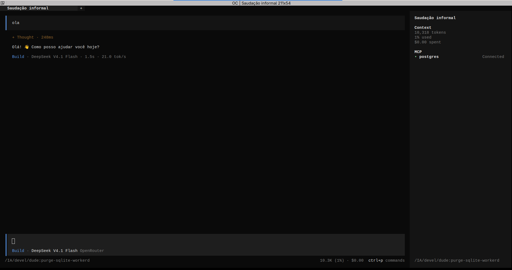

<p align="center">
  
</p>
<p align="center">AI coding agent for the terminal — a PostgreSQL-backed fork of opencode.</p>
<p align="center">
  <a href="https://github.com/luide/dude/actions/workflows/release-dude.yml"></a>
  
</p>

---

**dude** is a personal fork of [opencode](https://github.com/anomalyco/opencode), rebranded and adapted for a self-hosted setup. The agent, TUI, server and SDK are opencode's; the differences live in storage, provider, branding, and distribution.

### What's different from opencode

- **PostgreSQL storage** — the SQLite / Durable-Object (workerd) storage stack is replaced by PostgreSQL (`@effect/sql-pg`). No SQLite, no Cloudflare Workers backend.
- **OpenRouter provider** — ships configured for OpenRouter; the opencode cloud ("remote"/zen) provider is disabled.
- **`dude` branding** — binary, command, TUI logo, prompts and config all say `dude`. Build-time defines and env vars use `DUDE_*`, with the legacy `OPENCODE_*` names still honored (mirrored at startup).
- **Config** — read from `dude.json`/`dude.jsonc` (the `opencode.*` names still work) and from `dude`-named dirs (`~/.config/dude`, `/etc/dude`, …), falling back to the `opencode` dirs when present.
- **Self-updates** point at this repo's GitHub Releases, not opencode.ai. Discord and other upstream-only integrations were removed.

### Requirements

- **PostgreSQL** — a database and login role named `dude` on the local socket:
  ```bash
  createdb dude            # owner role "dude"
  ```
  Override with `DUDE_DATABASE_URL` / `OPENCODE_DATABASE_URL`, or the standard `PGHOST`/`PGDATABASE`/`PGUSER`.
- **An OpenRouter API key** in the environment:
  ```bash
  export OPENROUTER_API_KEY=sk-or-...
  ```

### Installation

```bash
# Nix (builds from source)
nix run github:luide/dude

# Install script (downloads a release binary into ~/.dude/bin)
curl -fsSL https://raw.githubusercontent.com/luide/dude/dev/install | bash

# From source
git clone https://github.com/luide/dude && cd dude
bun install
cd packages/cli
bun run script/build.ts --single --skip-web-ui --outdir=dist
install -m755 dist/cli-*/bin/dude /usr/local/bin/dude
```

> The install script and `dude upgrade` require published GitHub Releases
> (`dude-<target>.tar.gz` assets, produced by the `release-dude` workflow on a
> `v*` tag). Until a release exists, use Nix or a source build.

### Configuration

System-wide config lives in `/etc/dude/dude.json`; per-user config in `~/.config/dude/dude.json`. Example:

```jsonc
{
  "enabled_providers": ["openrouter"],
  "model": "openrouter/deepseek/deepseek-v4.1-flash"
}
```

Keep secrets out of the config file by exporting them from the environment (e.g. a login-shell `/etc/profile.d/dude.sh` with `export OPENROUTER_API_KEY=...`).

### Agents

Two built-in agents, switchable with `Tab`:

- **build** — default, full-access agent for development work
- **plan** — read-only agent for analysis and exploration

A **general** subagent handles complex searches and multistep tasks (`@general`).

### Credits & license

dude builds entirely on [opencode](https://github.com/anomalyco/opencode) by Anomaly, and is not affiliated with or endorsed by the opencode team. Distributed under the MIT License, like upstream.
